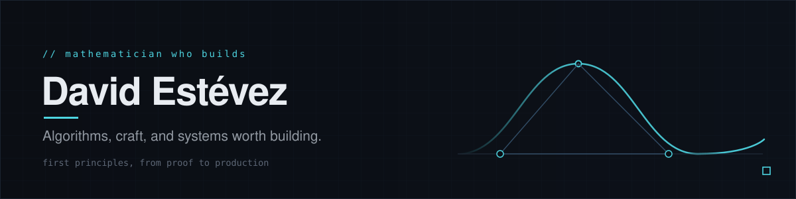

<picture>
  <source media="(prefers-color-scheme: light)" srcset="https://raw.githubusercontent.com/destbreso/destbreso/main/assets/hero-light.svg" />
  
</picture>

**Mathematician & software developer.** I build systems from first principles: the same discipline that proves a theorem, pointed at production code.

> The same rigor you apply to a topology proof can design a bulletproof distributed system.

`B.Sc. Mathematics, U. de La Habana` &nbsp;·&nbsp; `Miami, FL` &nbsp;·&nbsp; `English / Spanish` &nbsp;·&nbsp; currently CTO [@Coverfleet](https://coverfleet.com)

### `01` · Building

- **[agentic-lab](https://github.com/destbreso/agentic-lab)**: a platform for autonomous agentic loops and AI workflows. Multi-provider, tool orchestration, real-time dashboard.
- **[cv-generator](https://github.com/destbreso/cv-generator)**: an AI-powered, privacy-first resume builder. Local (Ollama) or cloud LLMs tailor a CV to any role, with live pagination and a print-ready layout.
- **[load-testing-lab](https://github.com/destbreso/load-testing-lab)**: production load testing done properly. k6 + Artillery runners, InfluxDB metrics, Grafana dashboards, a real CLI.

[all repositories →](https://github.com/destbreso?tab=repositories)

### `02` · Writing

I write about algorithms with a mathematician's eye at **[destbreso.com/blog](https://destbreso.com/blog)**. The through-line is *Algorithms Under a Handicap*: methods that have to work with less, less memory, less time, or no view of the future.

### `03` · One year, a week at a time

Each column is a week of the last year, the newest on the right: public work in cyan, private work in violet, this week's column still being written. A small robot walks the year, stops to look up at the busiest week and turns around at this one, pleased when it runs above the year's average. Generated daily from real data; on [the data page](https://destbreso.github.io/destbreso/) any week can be read, and the robot sent to it.

---

<a href="https://destbreso.com">destbreso.com</a> &nbsp;·&nbsp;
<a href="https://destbreso.com/blog">blog</a> &nbsp;·&nbsp;
<a href="https://linkedin.com/in/destbreso">linkedin</a> &nbsp;·&nbsp;
<a href="https://x.com/destbreso">x</a> &nbsp;·&nbsp;
<a href="https://destbreso.github.io/destbreso/">the data of how I work →</a>

