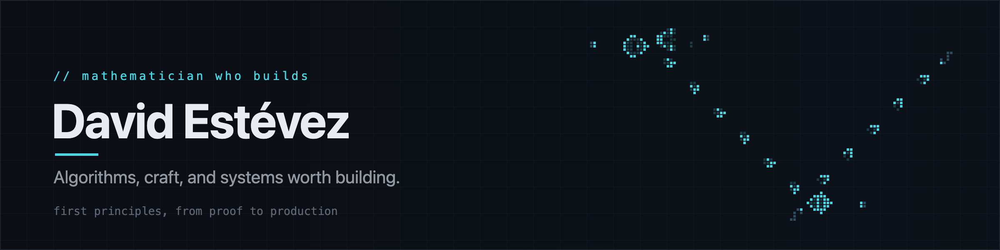
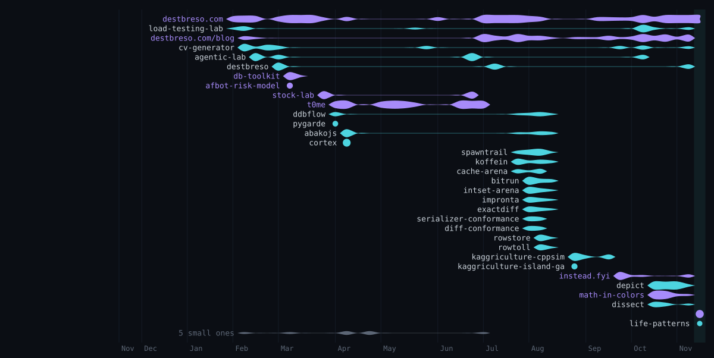

<picture>
  <source media="(prefers-color-scheme: light)" srcset="https://raw.githubusercontent.com/destbreso/destbreso/main/assets/hero-light.gif" />
  
</picture>

I studied mathematics, and my trade is building software. That can look like an odd turn for someone who loves rigor, abstraction and things you can't touch, but if you think about it, it follows. What I really love is solving problems, and I use whatever I have at hand to do it. Mathematics gives me the discipline of approximation, the rigor of analysis and the habit of discovery, and programming is just a tool.

The problems I enjoy most are the ones I can't understand until I start trying to solve them. It sounds absurd, I know, but trust me: standing in front of something you can't measure, with no idea how it ends, is addictive. It's the same pull that makes people climb huge mountains or want to go to space. We're explorers, it's what defines us as a species, and I think this is how that gene shows up in me.

My way of facing them is a peculiar one, and I've been refining it for years. I still feel the same vertigo at the start, but I've learned to trust the process: one step leads to the next, and there is no finish line. Most of the problems I take on never end up solved; they keep getting solved along the way.

I like trusting that small, simple parts will end up working together and solving something complex that none of them could solve alone. I'm a little obsessed with complex systems, with the idea that a small amount of information at the start can grow into something immensely complex and unexpected. I like to think that life works like that, and intelligence, and society. And I like building things that work like that.

The circuit up there is that idea at its smallest. It's Conway's Game of Life: a grid where every cell lives or dies by the same three rules, and out of those rules come a gun firing gliders, a reflector turning them and an eater swallowing them. I put them together in a small language I made for building circuits out of gliders. In [the lab on destbreso.com](https://destbreso.com/interactive/game-of-life) it runs in your browser, and the same language builds logic gates, a bit of memory and an adder that sums two numbers with nothing but gliders.

`B.Sc. Mathematics, U. de La Habana` &nbsp;·&nbsp; `Miami, FL` &nbsp;·&nbsp; `English / Spanish` &nbsp;·&nbsp; currently CTO [@Coverfleet](https://coverfleet.com)

 

**[destbreso.com](https://destbreso.com)** is where I keep what I build: the lab, the blog, the films, and a few things you have to find on your own.

The robot on the right lives there, somewhere in the dark. It doesn't come when called.

 

### `01` · Building

- **[dissect](https://github.com/destbreso/dissect)**: describe a process to your agent (a CI pipeline, a request through your architecture, a cipher's rounds) and it builds an interactive figure of it you can step through.
- **[depict](https://github.com/destbreso/depict)**: turns an idea into an illustrated explainer, a sentence a beat, presented by a guide character. One of the guides was drawn by my daughter.
- **[instead.fyi](https://instead.fyi)**: mortgages and household debt as simulations. Every screen holds one decision against its alternative, and it never names a winner.
- **[cv-generator](https://github.com/destbreso/cv-generator)**: a resume builder where the LLM you choose, local or in the cloud, tailors your CV to a role, and nothing leaves your browser.
- **[agentic-lab](https://github.com/destbreso/agentic-lab)**: a platform for running autonomous agent loops across LLM providers, with their tools and a live dashboard.

[all repositories →](https://github.com/destbreso?tab=repositories)

### `02` · The lab

Simulations I build to understand something, all of them running in the browser.

   

Circuits made of gliders &nbsp;·&nbsp; an ant colony that finds its food with no plan &nbsp;·&nbsp; how a path gets found &nbsp;·&nbsp; data structures you can watch work. <a href="https://destbreso.com/interactive">All of the lab →</a>

### `03` · Writing and films

I write about algorithms with a mathematician's eye at **[destbreso.com/blog](https://destbreso.com/blog)**. The through-line is _Algorithms Under a Handicap_: methods that have to work with less, less memory, less time, or no view of the future. Some of what I build becomes a short film [on YouTube](https://youtube.com/@sagekage010).

### `04` · The year, a thread a project

<picture>
  <source media="(prefers-color-scheme: light)" srcset="https://raw.githubusercontent.com/destbreso/destbreso/output/year-light.svg" />
  
</picture>

Every project I worked on in the last twelve months, in the order they started, each thread thicker in the weeks it took more of my time: public projects in cyan with their names, private work in violet, named only where I chose to name it. Drawn every day from my commits; <a href="https://destbreso.github.io/destbreso/">the data page</a> has the rest: when I work, with what, and how the year went.

---

<a href="https://destbreso.com">destbreso.com</a> &nbsp;·&nbsp;
<a href="https://destbreso.com/blog">blog</a> &nbsp;·&nbsp;
<a href="https://linkedin.com/in/destbreso">linkedin</a> &nbsp;·&nbsp;
<a href="https://x.com/destbreso">x</a> &nbsp;·&nbsp;
<a href="https://destbreso.github.io/destbreso/">the data of how I work →</a>

